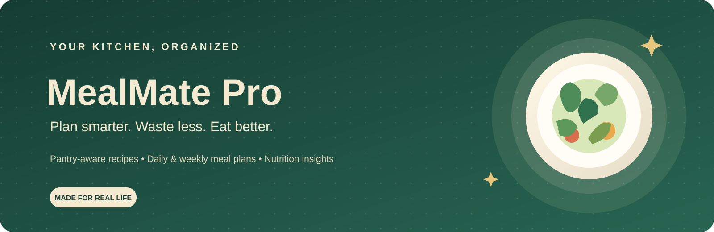
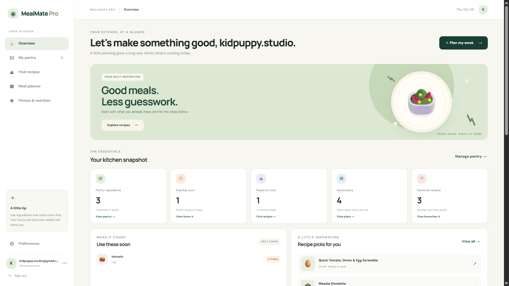
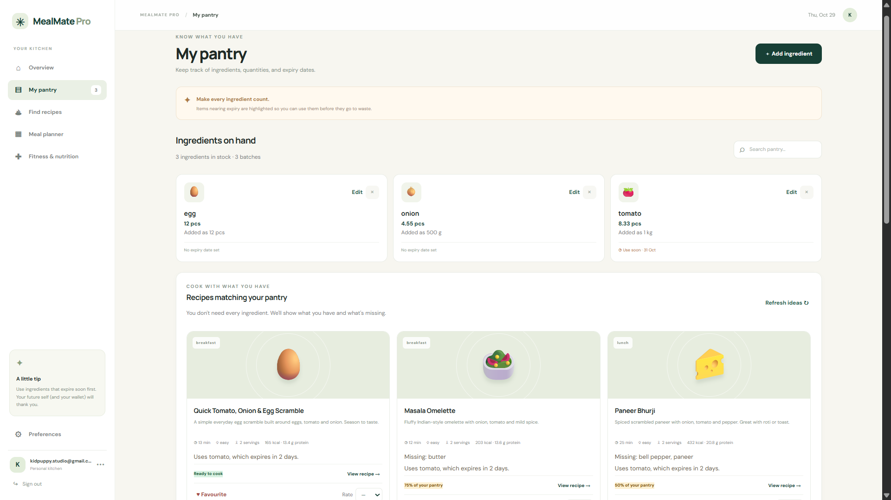
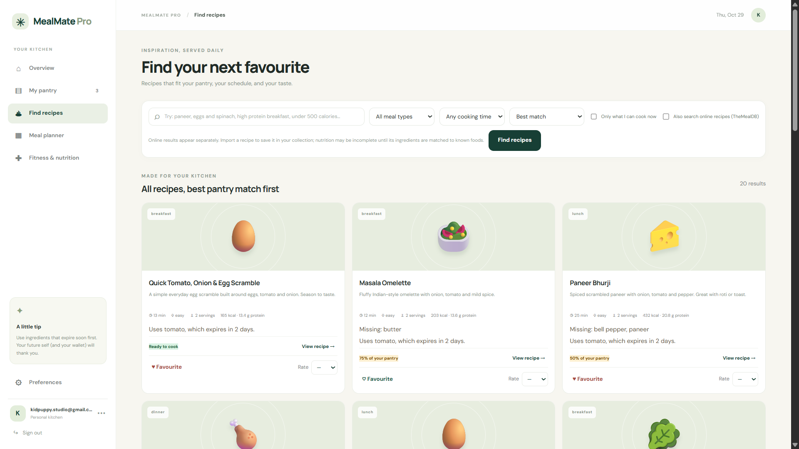
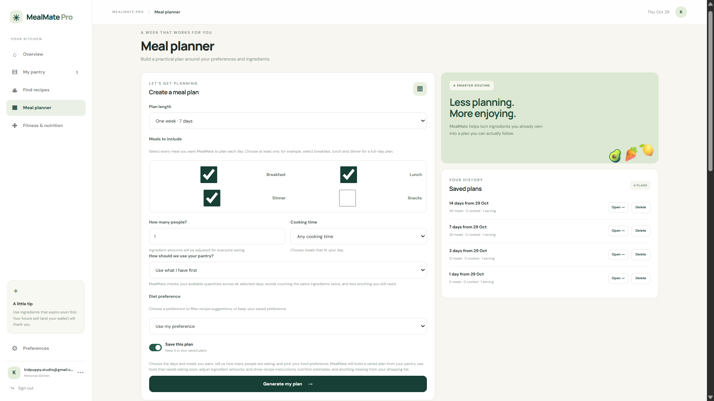
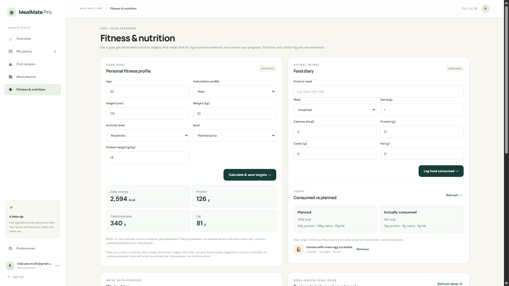

<div align="center">



### Plan smarter. Waste less. Eat better.

**A pantry-aware meal planner with recipe discovery, nutrition tracking, and fitness-focused food tools.**

<br>

[](https://mealmate-pro.onrender.com)
[](https://www.python.org/)
[](https://fastapi.tiangolo.com/)
[](https://www.sqlite.org/)
[](https://www.docker.com/)
[](LICENSE)

[Live Application](https://mealmate-pro.onrender.com) · [Report a Bug](https://github.com/SaiKiran0078/mealmate-pro/issues) · [GitHub Actions](https://github.com/SaiKiran0078/mealmate-pro/actions)

</div>

---

## 🌿 About the Project

**MealMate Pro** is a full-stack meal-planning application designed to help people make better use of the ingredients they already have. Manage pantry stock, explore recipes, create daily or weekly meal plans, check available nutrition information, and track food and workouts in one place.

The application is built with **FastAPI**, **SQLite**, **JWT authentication**, and a responsive **HTML, CSS, and JavaScript** frontend. It includes automated Python and JavaScript tests and a GitHub Actions workflow.

### Nutrition calculations: planned vs. eaten

- The **daily target cards** show estimated personal goals calculated from the fitness profile.
- When meals are planned for the selected day, the progress cards use the plan's **per-person totals** (calories, protein, carbohydrates, and fat) as the comparison target. The planned amount therefore matches the target used by the progress bars.
- The eaten progress cards compare diary entries against those same planned totals, showing the percentage consumed and the remaining amount. If no meals are planned, eaten progress falls back to the estimated personal daily targets.
- Overview and Fitness & Nutrition use the same frontend calculation so the progress numbers stay consistent between pages. Nutrition values are estimates and depend on the recipe data available.

> **Live demo:** [mealmate-pro.onrender.com](https://mealmate-pro.onrender.com)  
> Hosted services may take a short time to wake after inactivity. Nutrition values are estimates and depend on the available recipe and ingredient data.

## 🖥️ Application Screenshots

### Overview dashboard


### Pantry management


### Recipe discovery


### Daily and weekly meal planner


### Fitness and nutrition


---

## ✨ Features

| Feature | Description |
|---|---|
| 🧺 **Pantry management** | Track ingredients, quantities, units, batches, and expiry dates. |
| 🍲 **Recipe discovery** | Search the built-in recipe catalog and discover recipes from supported external sources. |
| 🗓️ **Daily and weekly planning** | Generate meal plans using selected meal types, servings, dietary preferences, and pantry availability. |
| ⏳ **Expiry-aware planning** | Highlight ingredients nearing expiry and help make better use of existing stock. |
| 🛒 **Grocery support** | Identify ingredients missing from planned meals and prepare a shopping list. |
| 🥗 **Nutrition summaries** | Review calories and macronutrients with decimal precision (for example, 13.4 g protein). |
| 💪 **Fitness tools** | Estimate daily calorie and macronutrient targets, log food and workouts, and compare planned versus consumed nutrition. |
| 📊 **Target progress** | See how much energy, protein, carbohydrate, and fat remains for the day, with progress bars and percentages on both Fitness & Nutrition and Overview. |
| ❤️ **Saved items** | Keep useful recipes and saved meal plans for later. |
| 🔐 **Account security** | JWT-based authentication and account-scoped application data. |
| 📱 **Responsive UI** | Navigate the application from desktop and mobile-sized screens. |

## 🧰 Technology Stack

| Layer | Technologies |
|---|---|
| Backend | Python, FastAPI, Pydantic |
| Authentication | JWT, password hashing |
| Data persistence | SQLite |
| Frontend | HTML5, CSS3, JavaScript |
| Tests | pytest, Node.js built-in test runner |
| Linting | Ruff |
| Deployment | Render configuration, Docker |
| API documentation | FastAPI OpenAPI / Swagger UI |

## 🗂️ Repository Structure

```text
mealmate-pro/
├── .github/
│   └── workflows/
│       └── ci.yml              # Python, JavaScript, and Docker checks
├── app/
│   ├── core/                   # Planning, nutrition, matching, search, and units
│   ├── integrations/           # External recipe integrations
│   ├── repositories/           # Database access and persistence
│   ├── routers/                # FastAPI endpoint handlers
│   ├── seed/                   # Built-in recipe catalog and seeding
│   ├── static/                 # HTML, CSS, and frontend JavaScript
│   ├── config.py               # Environment-based configuration
│   ├── db.py                   # Database initialization
│   ├── deps.py                 # Shared request dependencies
│   ├── main.py                 # FastAPI application factory
│   ├── schemas.py              # Request and response schemas
│   ├── security.py             # Authentication helpers
│   ├── serializers.py           # API serialization
│   └── services.py              # Application service layer
├── docs/
│   ├── assets/                 # README artwork
│   ├── screenshots/            # Real application screenshots
│   ├── API.md                  # API reference
│   ├── ARCHITECTURE.md         # Architecture notes
│   ├── AUDIT.md                # Project audit notes
│   ├── BUILD_GUIDE.md          # Build and setup guide
│   └── FEATURES.md             # Feature reference
├── tests/
│   ├── js/                     # JavaScript renderer tests
│   └── test_*.py               # Python API, service, and unit tests
├── .dockerignore
├── .env.example                # Safe environment-variable template
├── .gitignore
├── Dockerfile
├── docker-compose.yml
├── INTEGRATION.md
├── LICENSE
├── Makefile
├── pyproject.toml
├── render.yaml
├── requirements.txt
├── requirements-dev.txt
└── README.md
```

## 🚀 Run Locally

### Prerequisites

- Git
- Python **3.11 or 3.12**
- Node.js (for JavaScript tests)
- Docker Desktop (optional)

### 1. Clone the repository

```powershell
git clone https://github.com/SaiKiran0078/mealmate-pro.git
cd mealmate-pro
```

### 2. Create and activate a virtual environment

```powershell
py -3.12 -m venv .venv
.\.venv\Scripts\Activate.ps1
python -m pip install --upgrade pip
python -m pip install -r requirements-dev.txt
```

If PowerShell blocks activation, run the following in the current terminal and retry activation:

```powershell
Set-ExecutionPolicy -Scope Process -ExecutionPolicy Bypass
.\.venv\Scripts\Activate.ps1
```

### 3. Configure environment variables

```powershell
Copy-Item .env.example .env
python -c "import secrets; print(secrets.token_hex(32))"
notepad .env
```

Use the generated value for `JWT_SECRET` in `.env`. Keep secrets private and never commit `.env`.

### 4. Start the development server

```powershell
python -m uvicorn app.main:create_app --factory --reload --env-file .env
```

Open the application at **http://127.0.0.1:8000**. The interactive API documentation is available at **http://127.0.0.1:8000/docs**.

## 🧪 Run Tests and Quality Checks

Run from the project root with the virtual environment activated:

```powershell
python -m ruff check .
python -m pytest
node --check app/static/app.js
node --check app/static/render.js
node --test tests/js/*.test.js
```

The GitHub Actions workflow runs the Python and JavaScript checks on Python 3.11 and 3.12 and builds the Docker image.

**[View the latest GitHub Actions results →](https://github.com/SaiKiran0078/mealmate-pro/actions)**

## 🐳 Run with Docker

Create a local `.env` file with a strong `JWT_SECRET`, then run:

```powershell
docker compose up --build
```

Review `docker-compose.yml` and `render.yaml` to confirm the database path and persistent storage configuration for your environment. SQLite data must be stored on durable storage if it needs to survive container replacement or redeployment.

## ☁️ Deployment

The repository includes a Render Blueprint configuration (`render.yaml`).

1. Push the repository to GitHub.
2. In Render, create a Blueprint and connect this repository.
3. Review the service configuration and environment variables.
4. Set `JWT_SECRET` as a secret; do not commit credentials.
5. Confirm the SQLite database is stored on a persistent disk if data must survive redeployments.
6. Deploy and test registration, login, pantry updates, meal plans, food logs, and persistence.

Review the current hosting plan and persistent-storage costs before relying on a hosted instance for long-term personal data.

## 📚 Documentation

- [Features](docs/FEATURES.md)
- [API reference](docs/API.md)
- [Architecture](docs/ARCHITECTURE.md)
- [Build guide](docs/BUILD_GUIDE.md)
- [Audit notes](docs/AUDIT.md)
- [Integration notes](INTEGRATION.md)

## 🔐 Security and Data Notes

- Never commit `.env`, tokens, secrets, database files, or real user data.
- `.env.example` is a template only; populate local secrets privately.
- Back up persistent application data before making database changes.
- Nutrition values are estimates and may be incomplete depending on the source data.
- Use a unique, strong `JWT_SECRET` in deployed environments.

## 📄 License

This project is distributed under the MIT License. See [`LICENSE`](LICENSE).

---

<div align="center">

**Built to make everyday meal planning simpler.**

[Launch MealMate Pro](https://mealmate-pro.onrender.com) · [View Source](https://github.com/SaiKiran0078/mealmate-pro) · [Open an Issue](https://github.com/SaiKiran0078/mealmate-pro/issues)

</div>


## Nutrition comparison logic

The Overview and Fitness & Nutrition pages use the same `/nutrition/daily` response for the selected day. The interface separates three concepts so the numbers are not misleading:

- **Daily target** — personal goal calculated from the saved fitness profile.
- **Planned** — sum of per-serving nutrition for the meals currently planned for that day.
- **Eaten** — sum of food diary entries logged for that day.

Both pages show planned-versus-target and eaten-versus-target progress, including percentages and remaining amounts. Remaining values never go below zero; when an amount exceeds its target, the UI reports the amount over target. Removing planned meals clears the planned comparison without deleting food diary entries or changing personal targets.
