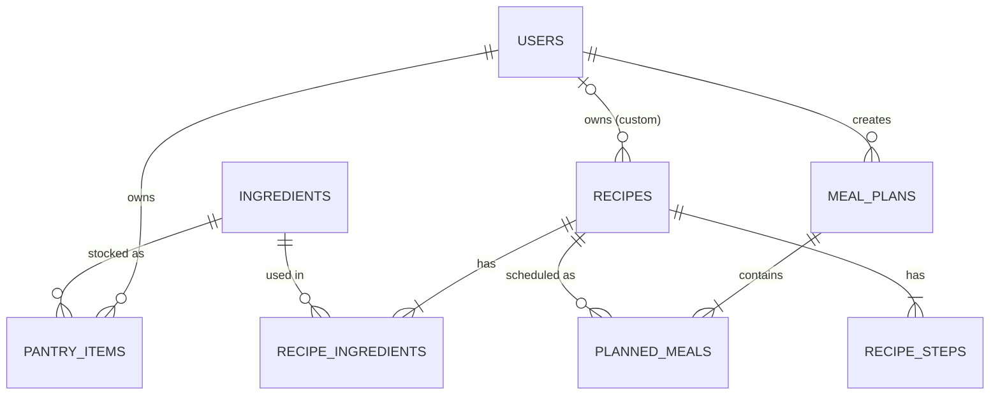

# Architecture

## Layers

```
HTTP request
    │
    ▼
routers/        Validate input (Pydantic), call a service, map errors to HTTP status codes
    │
    ▼
services.py     Use-cases: "create a plan", "cook a meal". Own the transaction.
    │        ┌───────────────────────────────┐
    ├──────► │ repositories/  (SQL only)     │ ──► SQLite
    │        └───────────────────────────────┘
    ▼
core/           Pure functions and dataclasses. No SQL, no HTTP, no clock.
```

Dependencies point **downwards only**. `core/` imports nothing from the rest of the app, which is why the
interesting logic can be unit-tested with plain Python objects in milliseconds.

"Today" is a parameter, never `date.today()` inside the engine, so tests are repeatable and a plan can be
generated for any start date.

## Data model



* `recipe_ingredients` is the **many-to-many junction** between recipes and ingredients and carries data of its own
  (quantity, preparation note, optional flag).
* `pantry_items` stores **one row per purchase**, so each batch keeps its own expiry date.
* `recipes.owner_id IS NULL` means shared catalog (built-in and imported); otherwise the recipe is private to that user.

## Algorithms

### Unit normalisation (`core/units.py`)

All stored quantities are in the ingredient's base unit (`g`, `ml` or `pcs`). Conversions between families go through
grams using two per-ingredient facts: `density_g_per_ml` and `grams_per_piece`. If the needed fact is missing
(for example "2 pcs of milk") the code raises `UnitError` rather than guessing; the API turns that into a 422.

### First-expiring-first-out (`core/stock.py`)

`consume()` takes what a recipe needs from batches ordered by expiry date (undated last), skips batches that have
expired by the day of use, and reports whatever could not be covered as a **shortfall**.

### Recipe matching (`core/matcher.py`)

```
coverage = average over needed ingredients of  min(have / need, 1)
urgency  = min(1, Σ 1/(1 + days_left) over ingredients expiring within 3 days / 2)
score    = 100 × (0.7 × coverage + 0.3 × urgency)
```

Staples (salt, oil, spices) and optional ingredients are ignored. Every result carries human-readable reasons.

### Plan generation (`core/planner.py`)

A greedy algorithm over every day and meal slot, always working on a **copy** of the pantry:

```
score(slot, recipe) =  50 × coverage                 (can I cook it with what is left?)
                     + 20 × urgency                  (does it use expiring food?)
                     + 15 × calorie fit              (close to this meal's share of the daily target)
                     + 10 × variety                  (different cuisine from the previous meal)
                     +  5 × shared shopping          (reuses an ingredient we already plan to buy)
                     − 12 × times already used
```

The winner is "cooked" in the simulation, which removes its ingredients (first-expiring-first-out) and records any
shortfall. The sum of all shortfalls **is** the shopping list. Ties are broken by recipe id, so the same input always
gives the same plan.

Calorie share per meal: breakfast 25%, lunch 35%, dinner 40%, snack 10%, re-normalised over the meals requested.

### Shopping list (`core/grocery.py`)

Shortfalls are rounded **up** to buyable amounts (to 5 g, 10 g or 50 g depending on size; whole pieces) and grouped
by aisle (`ingredients.category`).

## Key decisions and trade-offs

| Decision | Why | Cost |
|---|---|---|
| SQLite + plain SQL | Zero setup, runs in a container, shows real SQL (joins, `GROUP BY`, indexes) | One writer at a time. See "Scaling" below |
| No ORM | Queries are explicit and easy to reason about in review | More boilerplate; migrations are manual |
| Greedy planner | Easy to explain, fast, deterministic, good enough in practice | Not globally optimal; can pick a locally good meal that hurts a later day |
| Meal types / diet tags as comma-separated text | Simple and filtered in Python (catalog is small) | Not indexable; a join table is the next step at scale |
| Standard-library password hashing (PBKDF2) | No native dependencies | bcrypt/argon2 are preferred in production |
| Responses are dicts, not response models | Fast to iterate | OpenAPI docs lack response schemas |
| Unknown nutrition is flagged (`nutrition_complete: false`) | Wrong numbers are worse than missing numbers | Imported recipes may show partial calories |

## Security notes

* Passwords: PBKDF2-HMAC-SHA256, 200 000 iterations, random 16-byte salt, constant-time compare.
* Login errors are identical for "no such email" and "wrong password".
* The app refuses to start without a `JWT_SECRET` of at least 16 characters.
* Every query that touches user data filters by `user_id`; other people's resources return 404, not 403.
* All SQL uses bound parameters. The few f-string fragments only splice generated `?` placeholders.
* The container runs as a non-root user.

## Known limitations

* No refresh tokens, password reset or rate limiting on login.
* Dates use the server's clock; per-user time zones are not modelled.
* The catalog has 19 recipes and 41 ingredients. Nutrition values are approximate, so this is not medical advice.
* Imported recipes use a default of 4 servings and cannot be converted when a measure is vague ("a handful").

## Scaling path

PostgreSQL (replace `sqlite3` calls in `repositories/`), Alembic migrations, a join table for tags with indexes,
Redis cache for the recipe catalog, and background jobs for expiry reminders.
